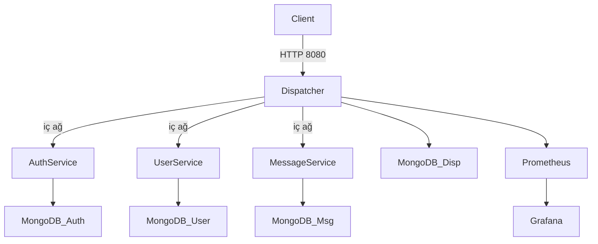

# Dispatcher Microservice Projesi

Ekip: Muhammed Emir Karaman & Nuh  
Tarih: Mart–Nisan 2026

## Mimari



## Kurulum

```bash
# 1. Repoyu klonla
git clone <repo-url>
cd dispatcher-project

# 2. Ortam değişkenlerini ayarla
cp .env.example .env

# 3. Tüm sistemi ayağa kaldır
docker-compose up --build

# 4. Erişim
#   Dispatcher  → http://localhost:8080
#   Grafana     → http://localhost:3000
#   Prometheus  → http://localhost:9090
```

## Servisler

| Servis | Port | Açıklama |
|--------|------|----------|
| Dispatcher | 8080 | API Gateway — tek dış giriş |
| Auth Service | iç ağ | Login / Register |
| User Service | iç ağ | Kullanıcı CRUD |
| Message Service | iç ağ | Mesajlaşma |
| Grafana | 3000 | Trafik görselleştirme |
| Prometheus | 9090 | Metrik toplama |

## API Dokümantasyonu

### Auth

| Method | Endpoint | Açıklama |
|--------|----------|----------|
| POST | `/auth/register` | Kullanıcı kaydı |
| POST | `/auth/login` | Giriş → JWT token |

### Users

| Method | Endpoint | Açıklama |
|--------|----------|----------|
| GET | `/users` | Tüm kullanıcılar |
| GET | `/users/{id}` | Tekil kullanıcı |
| POST | `/users` | Yeni kullanıcı |
| PUT | `/users/{id}` | Güncelle |
| DELETE | `/users/{id}` | Sil |

### Messages

| Method | Endpoint | Açıklama |
|--------|----------|----------|
| GET | `/messages` | Tüm mesajlar |
| POST | `/messages` | Mesaj gönder |
| DELETE | `/messages/{id}` | Mesaj sil |

## Testler

```bash
# Tüm testleri çalıştır
pytest

# Entegrasyon testleri (Docker gerekli)
docker-compose up -d
pytest tests/integration/

# Yük testi
k6 run load-tests/k6_dispatcher_test.js
```
