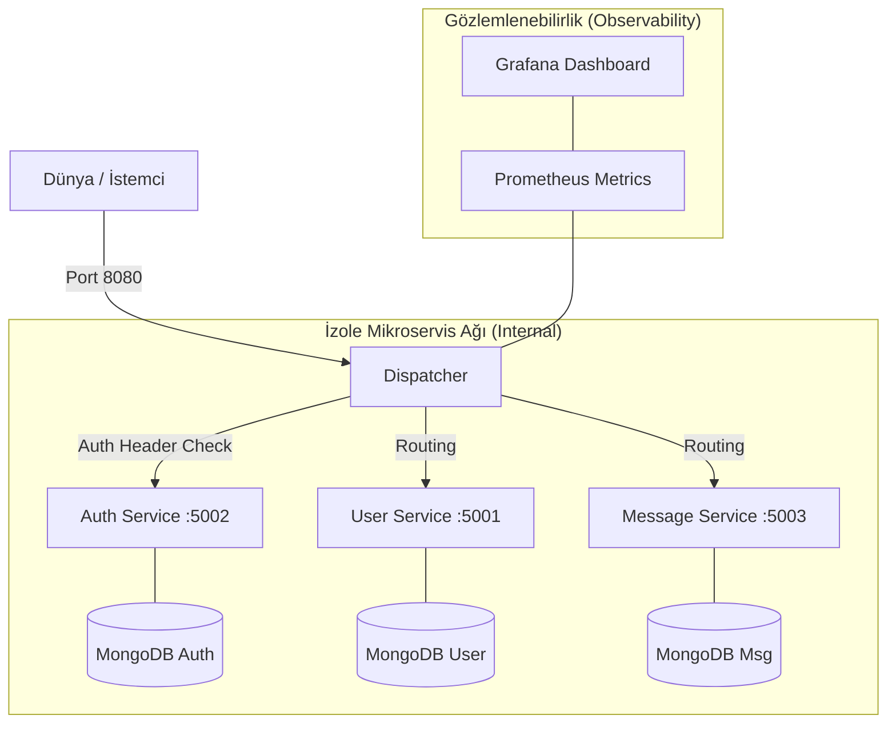
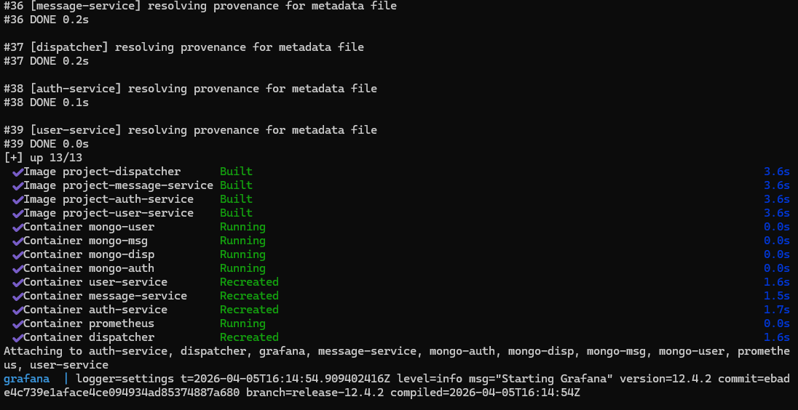
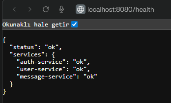
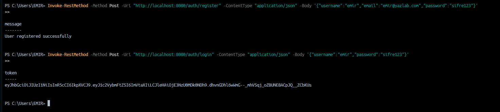
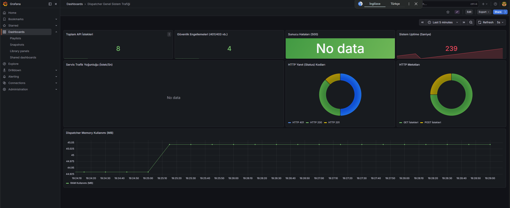
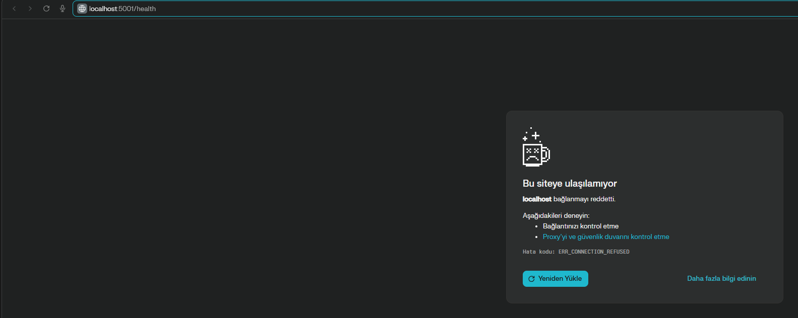

# 📡 Dispatcher — Mikroservis API Gateway Projesi

 


**Modern, Güvenli ve Yüksek Performanslı Mikroservis Yönetimi.**

Bu proje, bir **API Gateway (Dispatcher)** merkezli mikroservis mimarisinin (Auth, User, Message) nasıl kurgulanacağını, Richardson Maturity Model (Seviye 2) standartlarına uygunluğunu ve Docker ekosistemiyle nasıl izole edileceğini sergiler.

---

## 🏛 Sistem Mimarisi

Sistem, dış dünyaya kapalı olan mikroservislerin sadece **Dispatcher (Gateway)** üzerinden birleştirilmesi (Aggregation) prensibiyle çalışır.



---

## 🚀 Öne Çıkan Özellikler

- **🔐 JWT Güvenlik Katmanı**: Yetkisiz tüm istekler Dispatcher seviyesinde 401 Unauthorized ile engellenir.
- **⚡ Dinamik Rate Limiting**: Burst saldırılara karşı IP bazlı saniyelik sınırlama (429 Too Many Requests).
- **📡 Mikroservis İzolasyonu**: Servisler sadece iç ağda çalışır, doğrudan dışarıdan ulaşılamaz.
- **📊 Canlı İzleme (Observability)**: Prometheus ve Grafana entegrasyonu ile tam kontrol.
- **🧪 TDD Odaklı Geliştirme**: 100+ birim ve uçtan uca (E2E) test ile %100 güvenilirlik.

---

## 🖼 Doğrulama Galerisi (Ekran Görüntüleri)

Projenin tüm fonksiyonlarının çalıştığına dair 8 ana adımın kanıtları aşağıdadır:

### 1-4. Sistem Başlatma ve Güvenlik Testleri
| 1. Docker Logları | 2. Health Check | 3. JWT Token / Auth | 4. 401 Güvenlik Engeli |
|:---:|:---:|:---:|:---:|
|  |  |  |  |
| *Sistemin hatasız ayağa kalkış kanıtı.* | *Tüm servislerin sağlıklı (OK) durumu.* | *Auth servisinden alınan JWT.* | *Yetkisiz girişin engellenmesi.* |

### 5-6. Dashboard ve İzleme Panelleri
| 5. Trafik Dashboard | 6. Grafana Metrikleri |
|:---:|:---:|
|  |  |
| *Geliştirilmiş özel takip ekranı.* | *Sistemin kaynak ve performans metrikleri.* |

### 7. Performans ve Stres Testleri (k6)
| 7.1. Normal Yük Testi | 7.2. Chaos/Stres Testi |
|:---:|:---:|
|  |  |
| *Ortalam trafiğin izlenmesi.* | *Saldırı ve aşırı yük durumundaki tepki.* |

### 8. Ağ İzolasyonu Kanıtı
| 8.1. Doğrudan Erişim Engeli | 8.2. Gateway Üzerinden Erişim |
|:---:|:---:|
|  |  |
| *Mikroservislere dışarıdan ulaşılamadığı (Connection Refused).* | *İsteğin sadece Dispatcher (8080) üzerinden geçtiğinin ispatı.* |

---

## 🛠 Teknoloji Yığını

*   **Backend**: Python / Flask
*   **Database**: MongoDB (Her servis ayrı DB kullanır)
*   **DevOps**: Docker & Docker Compose
*   **Performance**: k6 Load Testing
*   **Monitoring**: Prometheus & Grafana
*   **Documentation**: Mermaid.js Diagrams

---

## 🏁 Hızlı Başlangıç

Sistemi tek bir komutla ayağa kaldırabilirsiniz:

```powershell
docker-compose up --build
```

- **Dashboard**: `http://localhost:8080/dashboard`
- **Health Check**: `http://localhost:8080/health`
- **Grafana**: `http://localhost:3000` (admin/admin)

---

## 👨‍💻 Hazırlayanlar

*   **Muhammed Emir Karaman**
*   **Nuh**

---
> [!TIP]
> Bu proje, mikroservis dünyasında modern güvenlik ve performans standartlarını uygulamak için bir referans niteliğindedir.
