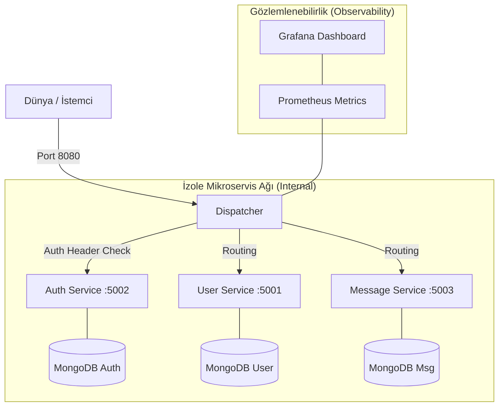
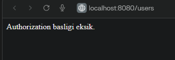
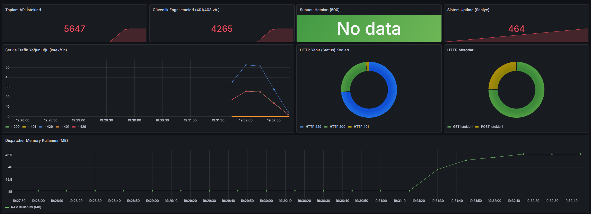

# 📡 Dispatcher — Mikroservis API Gateway Projesi

 


**Modern, Güvenli ve Yüksek Performanslı Mikroservis Yönetimi.**

Bu proje, bir **API Gateway (Dispatcher)** merkezli mikroservis mimarisinin (Auth, User, Message) nasıl kurgulanacağını, Richardson Maturity Model (Seviye 2) standartlarına uygunluğunu ve Docker ekosistemiyle nasıl izole edileceğini sergiler.

---

## 🏛 Sistem Mimarisi

Sistem, dış dünyaya kapalı olan mikroservislerin sadece **Dispatcher (Gateway)** üzerinden birleştirilmesi (Aggregation) prensibiyle çalışır.



---

## 🚀 Öne Çıkan Özellikler

- **🔐 JWT Güvenlik Katmanı**: Yetkisiz tüm istekler Dispatcher seviyesinde 401 Unauthorized ile engellenir.
- **⚡ Dinamik Rate Limiting**: Burst saldırılara karşı IP bazlı saniyelik sınırlama (429 Too Many Requests).
- **📡 Mikroservis İzolasyonu**: Servisler sadece iç ağda çalışır, doğrudan dışarıdan ulaşılamaz.
- **📊 Canlı İzleme (Observability)**: Prometheus ve Grafana entegrasyonu ile tam kontrol.
- **🧪 TDD Odaklı Geliştirme**: 100+ birim ve uçtan uca (E2E) test ile %100 güvenilirlik.

## 🚀 Adım Adım Doğrulama ve Kanıtlar

Projenin tüm fonksiyonlarının çalıştığına dair teknik detaylar ve ekran görüntüleri aşağıdadır:

### 1. Sistem Başlatma
*   **Amacı:** Konteyner orkestrasyonunun hatasız çalıştığını doğrulamak.
*   **Komut:** `docker-compose up --build`
*   **Kanıt:**
    
    *Sistemin tüm servisleriyle birlikte (READY) ayağa kalkış anı.*

---

### 2. Sağlık Kontrolü (Health Check)
*   **Amacı:** Dispatcher'ın tüm mikroservisleri canlı olarak takip ettiğini kanıtlamak.
*   **URL:** `http://localhost:8080/health`
*   **Kanıt:**
    
    *Tüm servislerin sağlıklı (OK) olduğunu gösteren JSON çıktısı.*

---

### 3. Kimlik Doğrulama (JWT Auth)
*   **Amacı:** `auth-service` üzerinden güvenli bir şekilde JWT üretildiğini doğrulamak.
*   **Komut (PS):** `Invoke-RestMethod -Method Post -Uri "http://localhost:8080/auth/login" -ContentType "application/json" -Body '{"username":"emir","password":"sifre123"}'`
*   **Kanıt:**
    
    *Başarılı giriş sonrası sistemden alınan 256-bit JWT anahtarı.*

---

### 4. Güvenlik Bariyeri (401 Unauthorized)
*   **Amacı:** Yetkisiz isteklerin Dispatcher seviyesinde durdurulduğunu kanıtlamak.
*   **URL:** `http://localhost:8080/users`
*   **Kanıt:**
    
    *Token olmadan yapılan isteğin 401 hatasıyla reddedilmesi.*

---

### 5. Canlı Trafik Dashboard
*   **Amacı:** Geliştirilen "Glassmorphism" Dashboard'un gerçek zamanlı verileri işlediğini göstermek.
*   **URL:** `http://localhost:8080/dashboard`
*   **Kanıt:**
    
    *Sistemdeki anlık trafiği ve durum kodlarını gösteren özel arayüz.*

---

### 6. Gözlemlenebilirlik (Grafana)
*   **Amacı:** Prometheus ve Grafana üzerinden sistem kaynaklarının izlenebildiğini doğrulamak.
*   **URL:** `http://localhost:3000` (admin/admin)
*   **Kanıt:**
    
    *Grafana üzerinde görselleştirilen sistem metrikleri.*

---

### 7. Performans ve Stres Testleri (k6)
*   **Amacı:** Sistemin yük altındaki stabilitesini ve Rate Limiter (429) tepkisini ölçmek.
*   **Komut (PS):** `Get-Content "Desktop/Project/scripts/load.js" | docker run --rm -i grafana/k6 run -`

| 7.1. Normal Yük (load.js) | 7.2. Chaos/Stres (chaos.js) |
|:---:|:---:|
|  |  |
| *50 kullanıcı altındaki stabilite.* | *Aşırı yükte devreye giren 429 kısıtlaması.* |

---

### 8. Ağ İzolasyonu ve Yönlendirme
*   **Amacı:** Servislerin izole olduğunu ve sadece Gateway üzerinden erişilebildiğini kanıtlamak.

| 8.1. Doğrudan Erişim (Engellendi) | 8.2. Gateway Erişimi (Başarılı) |
|:---:|:---:|
|  |  |
| *Mikroservise direkt ulaşım reddi.* | *8080 üzerinden yönlendirilen trafik.* |

---

## 🛠 Teknoloji Yığını

*   **Backend**: Python / Flask
*   **Database**: MongoDB (Her servis ayrı DB kullanır)
*   **DevOps**: Docker & Docker Compose
*   **Performance**: k6 Load Testing
*   **Monitoring**: Prometheus & Grafana
*   **Documentation**: Mermaid.js Diagrams

---

## 🏁 Hızlı Başlangıç

Sistemi tek bir komutla ayağa kaldırabilirsiniz:

```powershell
docker-compose up --build
```

- **Dashboard**: `http://localhost:8080/dashboard`
- **Health Check**: `http://localhost:8080/health`
- **Grafana**: `http://localhost:3000` (admin/admin)

---

## 👨‍💻 Hazırlayanlar

*   **Muhammed Emir Karaman**
*   **Nuh**

---
> [!TIP]
> Bu proje, mikroservis dünyasında modern güvenlik ve performans standartlarını uygulamak için bir referans niteliğindedir.
