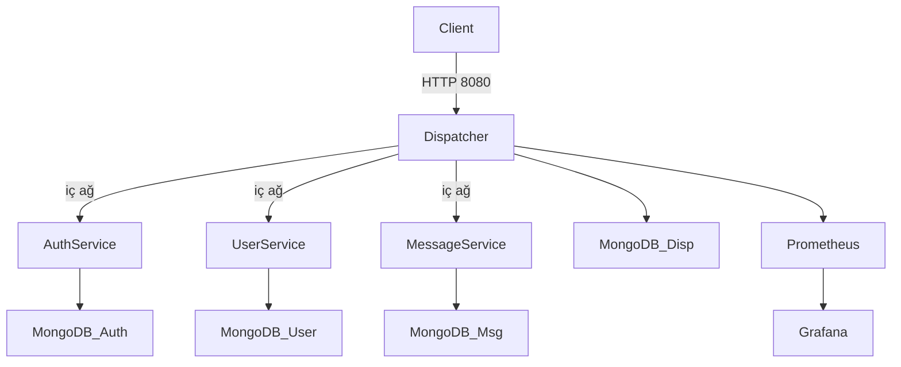

# Dispatcher Microservice Projesi

**Ekip:** Muhammed Emir Karaman & Nuh  
**Tarih:** Mart–Nisan 2026 | **Teslim:** 5 Nisan 2026

## Mimari



## Kurulum

```bash
# 1. Repoyu klonla
git clone <repo-url>
cd dispatcher-project

# 2. Ortam değişkenlerini ayarla
cp .env.example .env
# .env dosyasını açıp JWT_SECRET'ı değiştir

# 3. Tüm sistemi ayağa kaldır
docker-compose up --build

# 4. Erişim
#   Dispatcher  → http://localhost:8080
#   Grafana     → http://localhost:3000  (admin / .env'deki GRAFANA_PASSWORD)
#   Prometheus  → http://localhost:9090
```

## Servisler

| Servis | Port | Açıklama |
|--------|------|----------|
| Dispatcher | 8080 | API Gateway — tek dış giriş |
| Auth Service | iç ağ | Login / Register |
| User Service | iç ağ | Kullanıcı CRUD |
| Message Service | iç ağ | Mesajlaşma |
| Grafana | 3000 | Trafik görselleştirme |
| Prometheus | 9090 | Metrik toplama |

## API Dokümantasyonu

### Sistem

| Method | Endpoint | Auth | Açıklama |
|--------|----------|:----:|----------|
| GET | `/health` | ❌ | Tüm servislerin sağlık durumu |
| GET | `/metrics` | ❌ | Prometheus metrikleri |

### Auth

| Method | Endpoint | Auth | Açıklama |
|--------|----------|:----:|----------|
| POST | `/auth/register` | ❌ | Kullanıcı kaydı |
| POST | `/auth/login` | ❌ | Giriş → JWT token |

### Users

| Method | Endpoint | Auth | Açıklama |
|--------|----------|:----:|----------|
| GET | `/users` | ✅ | Tüm kullanıcılar |
| GET | `/users/{id}` | ✅ | Tekil kullanıcı |
| POST | `/users` | ✅ | Yeni kullanıcı |
| PUT | `/users/{id}` | ✅ | Güncelle |
| DELETE | `/users/{id}` | ✅ | Sil |

### Messages

| Method | Endpoint | Auth | Açıklama |
|--------|----------|:----:|----------|
| GET | `/messages` | ✅ | Tüm mesajlar |
| POST | `/messages` | ✅ | Mesaj gönder |
| DELETE | `/messages/{id}` | ✅ | Mesaj sil |

## Authentication

Korumalı (`Auth: ✅`) her endpoint'e istek atarken `Authorization` başlığı gereklidir:

```
Authorization: Bearer <token>
```

## Testler

```bash
# Tüm birim testlerini çalıştır
cd dispatcher && pytest -v

# Message service testleri
cd message-service && pytest -v

# E2E testler (dispatcher klasöründen)
pytest ../tests/e2e/test_full_lifecycle.py -v

# Yük testi (k6 gerekli: https://k6.io)
k6 run load-tests/dispatcher_load_test.js

# Tüm senaryoları çalıştır
bash load-tests/run_scenarios.sh
```

## Ortam Değişkenleri

| Değişken | Varsayılan | Açıklama |
|---|---|---|
| `JWT_SECRET` | `change-me-in-production` | JWT imzalama anahtarı |
| `GRAFANA_PASSWORD` | `admin` | Grafana admin şifresi |
| `LOG_LEVEL` | `INFO` | Log seviyesi |
| `RATE_LIMIT_PER_MINUTE` | `100` | IP başına istek limiti |

## Proje Yapısı

```
dispatcher-project/
├── dispatcher/              # API Gateway servisi
│   ├── src/
│   │   ├── app.py           # Flask entrypoint
│   │   ├── dispatcher.py    # Core routing engine
│   │   ├── router.py        # Path prefix resolver
│   │   ├── auth_middleware.py # JWT/token doğrulama
│   │   ├── rate_limiter.py  # Sliding window rate limiter
│   │   ├── health.py        # /health endpoint
│   │   └── templates/
│   │       └── traffic_dashboard.html
│   └── tests/               # Birim ve entegrasyon testler
├── auth-service/            # Kimlik doğrulama
├── user-service/            # Kullanıcı yönetimi
├── message-service/         # Mesajlaşma
├── monitoring/              # Prometheus & Grafana config
├── load-tests/              # k6 yük test senaryoları
├── docs/                    # Mimari, diyagramlar, rapor
├── tests/
│   └── e2e/                 # Uçtan uca testler
├── docker-compose.yml
└── .env.example
```
