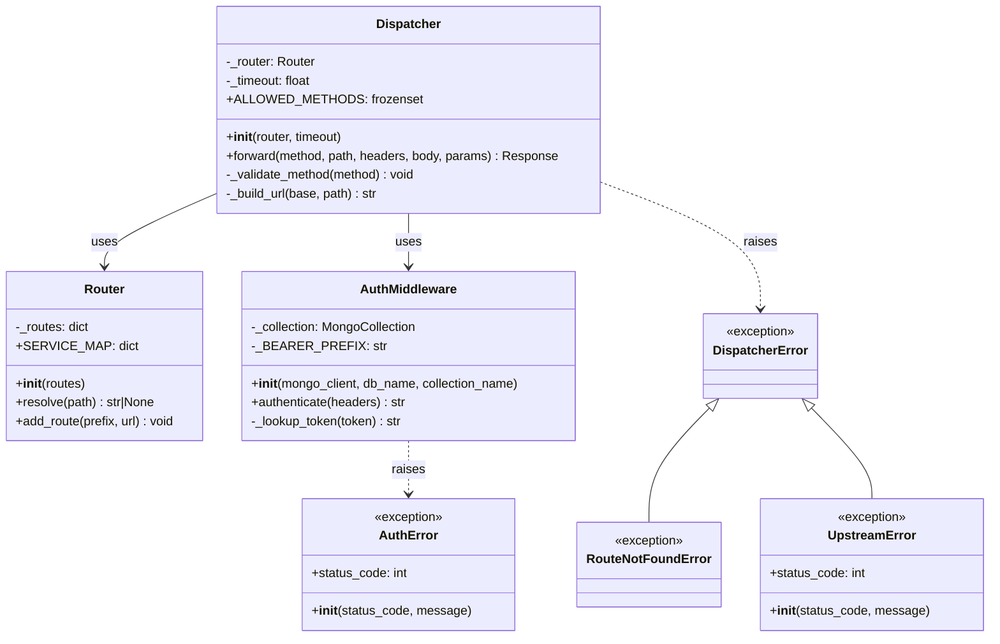
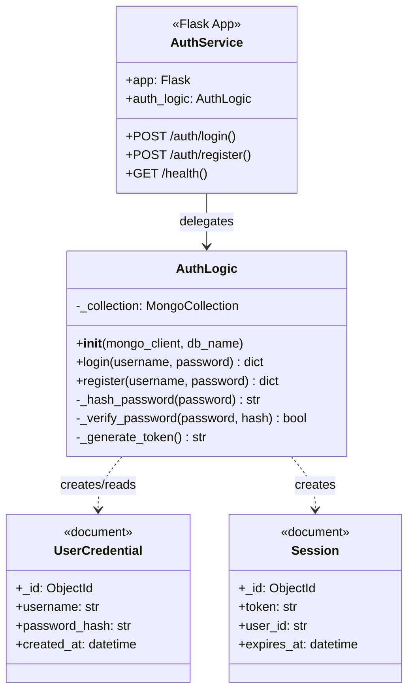
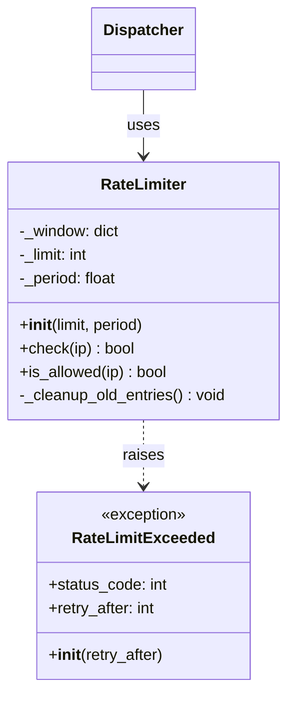
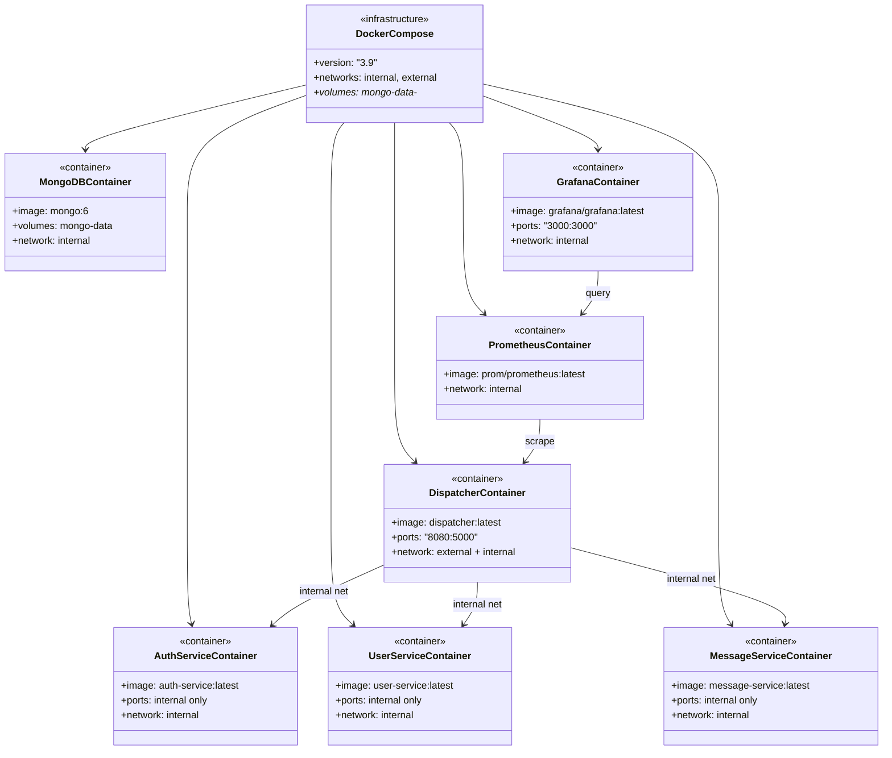

# Sınıf Diyagramları — Tüm Mikroservisler

**Commit 30 — 1 Nisan 2026 | Nuh**  
`docs: add class diagrams for all microservices (Mermaid)`

---

## 1. Dispatcher (API Gateway) — Tam Sınıf Diyagramı



---

## 2. Auth Service — Sınıf Diyagramı



---

## 3. User Service — Sınıf Diyagramı

```mermaid
classDiagram
    class UserService {
        <<Flask App>>
        +app: Flask
        +repo: UserRepository
        +GET  /users()
        +GET  /users/{id}()
        +POST /users()
        +PUT  /users/{id}()
        +DELETE /users/{id}()
        +GET  /health()
    }

    class UserRepository {
        -_collection: MongoCollection
        +__init__(mongo_client, db_name)
        +find_all() list
        +find_by_id(user_id) dict|None
        +create(data) str
        +update(user_id, data) bool
        +delete(user_id) bool
    }

    class UserDocument {
        <<document>>
        +_id: ObjectId
        +name: str
        +email: str
        +created_at: datetime
        +updated_at: datetime
    }

    UserService --> UserRepository : uses
    UserRepository ..> UserDocument : manages
```

---

## 4. Message Service — Sınıf Diyagramı

```mermaid
classDiagram
    class MessageService {
        <<Flask App>>
        +app: Flask
        +messages_db: dict
        +message_counter: int
        +GET  /messages()
        +POST /messages()
        +DELETE /messages/{id}()
        +GET  /health()
    }

    class MessageDocument {
        <<document>>
        +_id: str
        +sender: str
        +content: str
        +ts: int
    }

    MessageService ..> MessageDocument : manages
```

---

## 5. Tüm Sistem — Bileşen İlişkileri

```mermaid
classDiagram
    class Client {
        <<external>>
    }

    class Dispatcher {
        +forward(method, path, ...)
    }

    class AuthService {
        +POST /auth/login
        +POST /auth/register
    }

    class UserService {
        +GET  /users
        +POST /users
        +PUT  /users/{id}
        +DELETE /users/{id}
    }

    class MessageService {
        +GET  /messages
        +POST /messages
        +DELETE /messages/{id}
    }

    class MongoDB_Dispatcher {
        <<database>>
        +sessions: Collection
    }

    class MongoDB_Auth {
        <<database>>
        +credentials: Collection
        +sessions: Collection
    }

    class MongoDB_Users {
        <<database>>
        +users: Collection
    }

    class MongoDB_Messages {
        <<database>>
        +messages: Collection
    }

    class Prometheus {
        <<monitoring>>
        +scrape /metrics
    }

    class Grafana {
        <<visualization>>
        +dashboard: TrafficDashboard
    }

    Client --> Dispatcher : HTTP :8080
    Dispatcher --> MongoDB_Dispatcher : token lookup
    Dispatcher --> AuthService : /auth/*
    Dispatcher --> UserService : /users/*
    Dispatcher --> MessageService : /messages/*
    AuthService --> MongoDB_Auth : read/write
    UserService --> MongoDB_Users : CRUD
    MessageService --> MongoDB_Messages : CRUD
    Prometheus --> Dispatcher : scrape :8080/metrics
    Grafana --> Prometheus : query
```

---

## 6. RateLimiter — Sınıf Diyagramı (Commit 32 ile eklenecek)



---

## 7. Docker Bileşen Mimarisi


