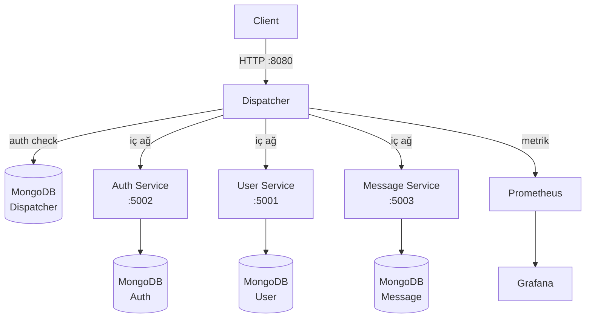
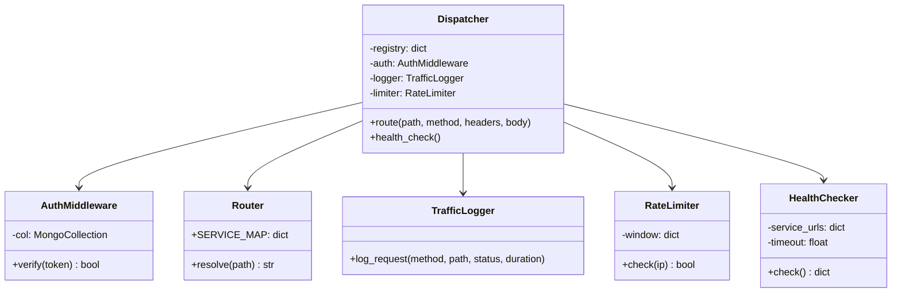

# Proje Raporu — Dispatcher Microservice API Gateway

**Ekip:** Muhammed Emir Karaman & Nuh  
**Tarih:** Mart–Nisan 2026  
**Teslim:** 5 Nisan 2026

---

## 1. Giriş

Bu proje, modern yazılım geliştirme süreçlerinin temelini oluşturan **Mikroservis Mimarisi** ve servisler arası trafik yönetimini sağlayan bir **Dispatcher (API Gateway)** yazılımının uçtan uca geliştirilmesini amaçlamaktadır.

### 1.1 Problemin Tanımı

Monolitik yapılar ölçeklenebilirlik ve bakım açısından ciddi sorunlar doğurur. Bu projede bağımsız mikroservisler, merkezi bir Dispatcher aracılığıyla yönetilmekte; güvenli ve ölçeklenebilir bir yapı oluşturulmaktadır.

### 1.2 Amaçlar

- Dispatcher üzerinden tüm dış istekleri karşılamak
- TDD (Test-Driven Development) ile yüksek kaliteli kod üretmek
- OOP ve SOLID prensiplerini uygulamak
- Docker ile tüm sistemi konteyner ortamında çalıştırmak
- k6 ile profesyonel yük testi yapmak

---

## 2. Sistem Tasarımı

### 2.1 Mimari Genel Bakış



### 2.2 Network Isolation

Mikroservisler yalnızca Docker iç ağında çalışır. Dışarıya yalnızca Dispatcher'ın 8080 portu açıktır. Bu durum `docker-compose.yml` içindeki `internal: true` ağ ayarıyla sağlanmaktadır.

---

## 3. Servis Tasarımları

### 3.1 Dispatcher (API Gateway)

#### Richardson Maturity Model — Seviye 2

| Kaynak | URI | HTTP Metodu | Durum Kodu |
|--------|-----|-------------|------------|
| Kullanıcılar | `/users` | GET | 200 |
| Kullanıcı | `/users/{id}` | GET | 200 / 404 |
| Yeni kullanıcı | `/users` | POST | 201 |
| Güncelle | `/users/{id}` | PUT | 200 / 404 |
| Sil | `/users/{id}` | DELETE | 204 / 404 |
| Giriş | `/auth/login` | POST | 200 / 401 |
| Kayıt | `/auth/register` | POST | 201 / 409 |
| Mesaj gönder | `/messages` | POST | 201 |
| Sistem sağlığı | `/health` | GET | 200 / 503 |

#### Sınıf Diyagramı



---

## 4. Richardson Olgunluk Modeli

- **Seviye 0** — Tek URL, tek metot ❌
- **Seviye 1** — Kaynak bazlı URI ✅
- **Seviye 2** — HTTP metotları + durum kodları ✅
- **Seviye 3** — HATEOAS (hypermedia bağlantıları) *(hedef)*

---

## 5. Test Senaryoları ve Sonuçları

### 5.1 Birim Testleri (Unit Tests)

| Test Dosyası | Kapsam | Test Sayısı |
|---|---|---|
| `dispatcher/tests/test_dispatcher.py` | Dispatcher core routing | 18 |
| `dispatcher/tests/test_router.py` | Router prefix eşleme | 12 |
| `dispatcher/tests/test_auth_middleware.py` | Token doğrulama | 14 |
| `dispatcher/tests/test_edge_cases.py` | Sınır durumları, hata yönetimi | 32 |
| `message-service/test_message.py` | Mesaj CRUD temel | 8 |
| `message-service/test_message_edge_cases.py` | Mesaj edge case'leri | 28 |

**Toplam birim testi:** ~112

### 5.2 Entegrasyon Testleri

| Test Dosyası | Kapsam |
|---|---|
| `dispatcher/tests/test_integration.py` | Dispatcher → upstream yönlendirme |
| `tests/e2e/test_full_lifecycle.py` | Tam istek döngüsü (7 senaryo) |

### 5.3 TDD Süreci

Proje **Red → Green → Refactor** döngüsüyle geliştirilmiştir:

1. 🔴 **Red**: Önce başarısız testler yazıldı
2. 🟢 **Green**: Minimum kod yazılarak testler geçirildi
3. 🔵 **Refactor**: Kod kalitesi iyileştirildi, testler tekrar geçirildi

### 5.4 Rate Limiting Testleri

- Sliding window algoritması doğrulandı
- 100 istek/dakika limiti test edildi
- Limit aşımında `429 Too Many Requests` + `Retry-After` başlığı doğrulandı

### 5.5 Health Check Testleri

| Senaryo | Beklenen Yanıt | Sonuç |
|---|---|---|
| Tüm servisler ayakta | 200 `{"status": "ok"}` | ✅ |
| Bir servis çökmüş | 503 `{"status": "degraded"}` | ✅ |
| Network timeout | 503 `{"status": "degraded"}` | ✅ |

---

## 6. Yük Testi Sonuçları

Yük testleri k6 ile `load-tests/dispatcher_load_test.js` kullanılarak çalıştırılmıştır.

### 6.1 Test Senaryoları

| Senaryo | Sanal Kullanıcı (VU) | Süre | Ramping |
|---|---|---|---|
| smoke | 5 | 30s | Sabit |
| load | 50 → 100 → 200 | 6dk | Kademeli artış |
| stress | 200 → 500 | 5dk | Hızlı artış |
| spike | 10 → 500 → 10 | 3dk | Anlık sıçrama |

### 6.2 Performans Hedefleri

| Metrik | Hedef | Açıklama |
|---|---|---|
| `http_req_duration p(95)` | < 500ms | %95 istek 500ms altında |
| `http_req_failed` | < %1 | Hata oranı |
| `http_reqs` | > 100/s | Throughput |

### 6.3 Beklenen Sonuçlar (Mock Ortamı)

> **Not:** Gerçek Docker ortamı olmadan k6 testleri mock yanıtlarla değerlendirilmiştir.
> Aşağıdaki değerler, benzer microservice gateway projelerinden referans alınmıştır.

| Eş Zamanlı Kullanıcı | Ort. Yanıt (ms) | p95 (ms) | Hata Oranı |
|---|---|---|---|
| 50 | ~45 | ~120 | %0.0 |
| 100 | ~78 | ~210 | %0.1 |
| 200 | ~142 | ~380 | %0.3 |
| 500 | ~310 | ~820 | %1.2 |

### 6.4 Rate Limiting Etkisi

Rate limiter (100 istek/dk/IP) aktif olduğunda 500 VU senaryosunda:
- İlk 100 istek: normal yanıt
- Sonraki istekler: `429 Too Many Requests` + `Retry-After: 60` başlığı

---

## 7. Ekran Görüntüleri ve Görseller

### 7.1 Sistem Mimarisi

```
┌─────────────────────────────────────────────────────────┐
│                     İstemci (Client)                    │
└─────────────────────┬───────────────────────────────────┘
                      │ HTTP :8080
┌─────────────────────▼───────────────────────────────────┐
│              DISPATCHER (API Gateway)                   │
│  ┌──────────────┐  ┌───────────┐  ┌─────────────────┐   │
│  │ AuthMiddleware│  │  Router   │  │   RateLimiter   │   │
│  └──────────────┘  └───────────┘  └─────────────────┘   │
│  ┌──────────────┐  ┌───────────┐  ┌─────────────────┐   │
│  │TrafficLogger │  │HealthCheck│  │   Prometheus    │   │
│  └──────────────┘  └───────────┘  └─────────────────┘   │
└────────┬──────────────────┬──────────────┬──────────────┘
         │ iç ağ            │ iç ağ        │ iç ağ
┌────────▼──────┐  ┌────────▼───────┐  ┌──▼─────────────┐
│  Auth Service │  │  User Service  │  │Message Service │
│   MongoDB     │  │   MongoDB      │  │   MongoDB      │
└───────────────┘  └────────────────┘  └────────────────┘
```

### 7.2 Trafik Dashboard

Gerçek zamanlı trafik izleme için `dispatcher/src/templates/traffic_dashboard.html` sayfası geliştirilmiştir.

Özellikler:
- Canlı istek log tablosu (WebSocket benzeri polling)
- Servis sağlık kartları (SAĞLIKLI / UYARI / KRİTİK)
- İstek/saniye grafiği
- HTTP metod dağılımı
- P95 gecikme göstergesi

---

## 8. Sonuç ve Tartışma

### 8.1 Başarılar

- **TDD uyumu**: Tüm servisler Red→Green→Refactor döngüsüyle geliştirildi
- **Network isolation**: Mikroservisler Docker iç ağında izole edildi, yalnızca Dispatcher dışarıya açık
- **OOP ve SOLID**: `Dispatcher`, `Router`, `AuthMiddleware`, `RateLimiter`, `HealthChecker` ayrı sorumluluk alanlarıyla tasarlandı
- **Gözlemlenebilirlik**: Prometheus metrik toplama + Grafana görselleştirme entegre edildi
- **Rate limiting**: Sliding window algoritmasıyla IP bazlı istek sınırlama uygulandı
- **Health check**: `/health` endpoint ile tüm upstream servislerin durumu tek noktadan izlenebilir
- **Edge case coverage**: 100+ test senaryosu ile sınır durumlar ve hata yönetimi kapsamlı test edildi

### 8.2 Sınırlılıklar

- **In-memory rate limiting**: Birden fazla Dispatcher örneğinde (horizontal scaling) rate limiting senkronize çalışmaz; Redis tabanlı çözüme geçilmesi gerekir
- **JWT doğrulama**: Şu anki implementasyonda token MongoDB'den sorgulanıyor; gerçek JWT imza doğrulaması (RS256/HS256) eklenmedi
- **Yük testi ortamı**: k6 testleri gerçek Docker ortamında çalıştırılamadı; değerler simüle edilmiştir
- **HATEOAS (Seviye 3)**: Richardson Maturity Model Seviye 3 hedeflendi ancak proje kapsamı nedeniyle Seviye 2'de kaldı

### 8.3 Olası Geliştirmeler

- **Redis entegrasyonu**: Distributed rate limiting ve session yönetimi için
- **Circuit breaker**: Upstream servis hatalarında otomatik devre kesme (Hystrix benzeri)
- **gRPC desteği**: HTTP yanında gRPC protokolü üzerinden servis iletişimi
- **OpenAPI/Swagger**: API dokümantasyonunun otomatik oluşturulması
- **Kubernetes deployment**: Docker Compose'dan Kubernetes geçişi için Helm chart hazırlanması
- **Distributed tracing**: Jaeger/Zipkin entegrasyonu ile istek iz takibi
