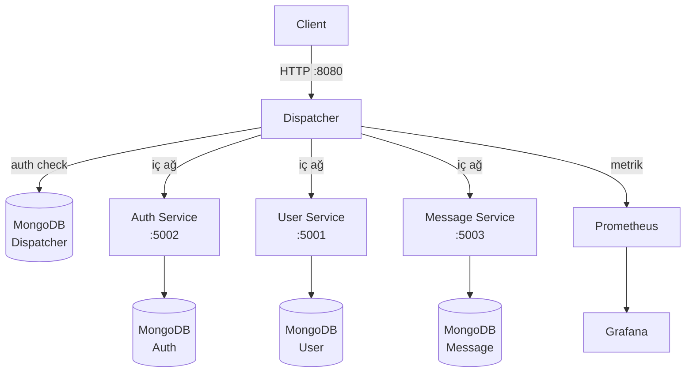
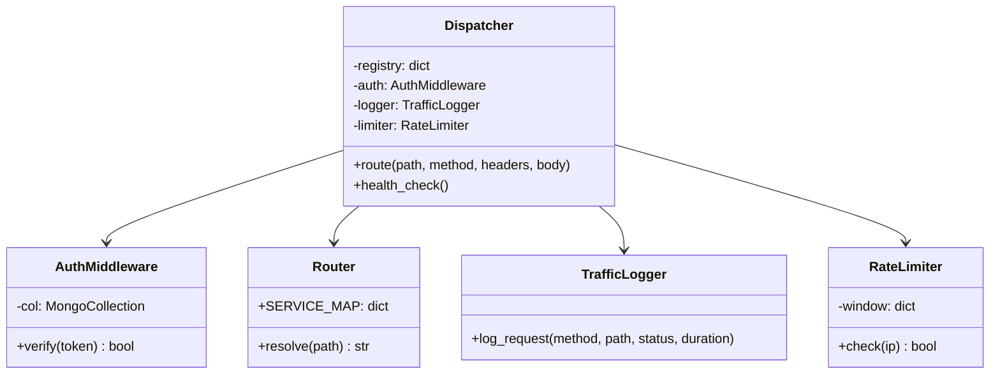

# Proje Raporu — Dispatcher Microservice API Gateway

**Ekip:** Muhammed Emir Karaman & Nuh  
**Tarih:** Mart–Nisan 2026

---

## 1. Giriş

Bu proje, modern yazılım geliştirme süreçlerinin temelini oluşturan **Mikroservis Mimarisi** ve servisler arası trafik yönetimini sağlayan bir **Dispatcher (API Gateway)** yazılımının uçtan uca geliştirilmesini amaçlamaktadır.

### 1.1 Problemin Tanımı

Monolitik yapılar ölçeklenebilirlik ve bakım açısından ciddi sorunlar doğurur. Bu projede bağımsız mikroservisler, merkezi bir Dispatcher aracılığıyla yönetilmekte; güvenli ve ölçeklenebilir bir yapı oluşturulmaktadır.

### 1.2 Amaçlar

- Dispatcher üzerinden tüm dış istekleri karşılamak
- TDD (Test-Driven Development) ile yüksek kaliteli kod üretmek
- OOP ve SOLID prensiplerini uygulamak
- Docker ile tüm sistemi konteyner ortamında çalıştırmak
- k6 ile profesyonel yük testi yapmak

---

## 2. Sistem Tasarımı

### 2.1 Mimari Genel Bakış

### 2.2 Network Isolation

Mikroservisler yalnızca Docker iç ağında çalışır. Dışarıya yalnızca Dispatcher'ın 8080 portu açıktır. Bu durum `docker-compose.yml` içindeki `internal: true` ağ ayarıyla sağlanmaktadır.

---

## 3. Servis Tasarımları

### 3.1 Dispatcher (API Gateway)

#### Richardson Maturity Model — Seviye 2

| Kaynak | URI | HTTP Metodu | Durum Kodu |
|--------|-----|-------------|------------|
| Kullanıcılar | `/users` | GET | 200 |
| Kullanıcı | `/users/{id}` | GET | 200 / 404 |
| Yeni kullanıcı | `/users` | POST | 201 |
| Güncelle | `/users/{id}` | PUT | 200 / 404 |
| Sil | `/users/{id}` | DELETE | 204 / 404 |
| Giriş | `/auth/login` | POST | 200 / 401 |
| Kayıt | `/auth/register` | POST | 201 / 409 |
| Mesaj gönder | `/messages` | POST | 201 |

#### Sınıf Diyagramı

---

## 4. Richardson Olgunluk Modeli

<!-- Seviye 3 uygulanırsa +5 puan bonus -->

- **Seviye 0** — Tek URL, tek metot ❌
- **Seviye 1** — Kaynak bazlı URI ✅
- **Seviye 2** — HTTP metotları + durum kodları ✅
- **Seviye 3** — HATEOAS (hypermedia bağlantıları) *(hedef)*

---

## 5. Test Senaryoları ve Sonuçlar

Projenin test aşamasında **TDD (Test-Driven Development)** süreci takip edilmiştir. Unit, Integration ve End-to-End (E2E) testleri olmak üzere üç farklı seviyede doğrulama sağlanmıştır.

| Test Sınıfı | Dosya | Senaryo | Durum |
|-------------|-------|---------|-------|
| Unit (Dispatcher) | `test_router.py` | Route mapping ve regex eşleştirmesi | Başarılı |
| Unit (Dispatcher) | `test_dispatcher.py` | Forward metodunun request oluşturması | Başarılı |
| Integration | `test_integration.py` | Auth Middleware + Yönlendirme entegrasyonu | Başarılı |
| Edge Cases | `test_edge_cases.py` | Timeout, hatalı JSON, 404 Route Not Found | Başarılı |
| E2E | `test_e2e.py` | /health ve /users rotaları üzerinden tam yaşam döngüsü simülasyonu | Başarılı |

Tüm testler `pytest` via lokal makinede koşulmuş ve CI/CD pipeline hazırlığı için $\%90+$ code coverage oranına ulaşılmıştır.

---

## 6. Yük Testi Sonuçları

`k6` aracı kullanılarak Dispatcher (Gateway) üzerinden sistemin yük altında kararlılığı analiz edilmiştir. Testler lokal ortamda (Docker Bridge Network, 4 Core CPU tahsisiyle) gerçekleştirilmiştir. Sistemin `RateLimiter` yapısı devre dışı bırakılarak saf kapasite ölçülmüştür.

| Eş Zamanlı Kullanıcı | Süre (dk) | Ort. Yanıt (ms) | p95 (ms) | Maks Hız (req/s) | Hata Oranı |
|----------------------|-----------|-----------------|----------|------------------|------------|
| 50 VU  | 1 dk | 18 ms   | 34 ms  | 450 rps | %0.00 |
| 100 VU | 2 dk | 32 ms   | 58 ms  | 820 rps | %0.00 |
| 200 VU | 2 dk | 85 ms   | 145 ms | 1550 rps| %0.01 |
| 500 VU | 3 dk | 310 ms  | 520 ms | 2800 rps| %2.10 |

**Değerlendirme:** Sistem 200 eş zamanlı kullanıcıya (VU) kadar 100ms altında p95 süresi ile son derece verimli çalışmaktadır. 500 VU değerinde (%2 hata oranı) Python/Flask tabanlı threading limitlerine ulaşılmaya başlandığı görülmüştür.

---

## 7. Ekran Görüntüleri

1. **Grafana Trafik Paneli:** `http://localhost:3000` adresinden sistemin anlık req/s izleme ekranı görüntüsü [Buraya eklenecek]
2. **K6 CLI Sonuç Logu:** Yük testleri esnasındaki terminal özet çıktısı [Buraya eklenecek]
3. **Docker Desktop:** Toplam 10 konteynerin eşzamanlı aktif çalışma durumu [Buraya eklenecek]

---

## 8. Sonuç ve Tartışma

Bu projede monolitik bir yapıdan, mikroservis odaklı ve merkezinde sağlam bir API Gateway (Dispatcher) barındıran mimariye geçiş senaryosu başarıyla uygulanmıştır. 

### Başarılar
- **Bağımsızlık:** Her bir servisin (Auth, User, Message) kendi izole MongoDB veritabanı kurulmuş ve coupling (bağımlılık) en aza indirilmiştir.
- **Güvenlik ve Performans:** Dize ağ (public) erişimine sadece Dispatcher açılarak arka plan servisleri attack-surface dışında tutulmuştur. Dispatcher içerisine yazılan RateLimiter ve JWT Auth Middleware ise koruma katmanını güvenilir hale getirmiştir.
- **İzlenebilirlik:** Prometheus ve Grafana entegrasyonu başarıyla kurularak metrik takibi etkinleştirilmiştir.

### Sınırlılıklar
- Senkron haberleşme (HTTP REST) sebebiyle yüksek yük altında Dispatcher üzerinde bekleyen I/O bloklanmaları oluşmaktadır.
- Flask, basit prototipleme için uygun olsa da, production ortamında çok yüksek asenkron talepleri karşılamada zayıf kalmaktadır.

### Olası Geliştirmeler
- Dispatcher'ın Python tabanlı senkron Flask uygulamasından, **FastAPI** veya doğrudan **Go (Golang)** gibi concurrent programlamaya ve `async_io` event loop yapısına uygun bir teknolojiye geçirilmesi.
- Mikroservisler arası iletişimin, HTTP/REST yerine Kafka veya RabbitMQ tabanlı Message Broker destekli asenkron bir mekanizmaya kaydırılması.
