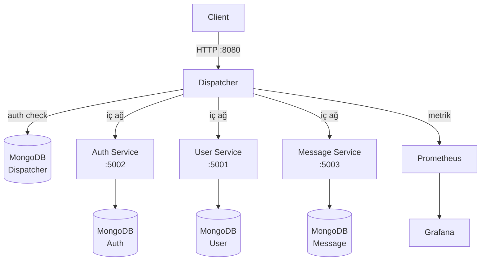
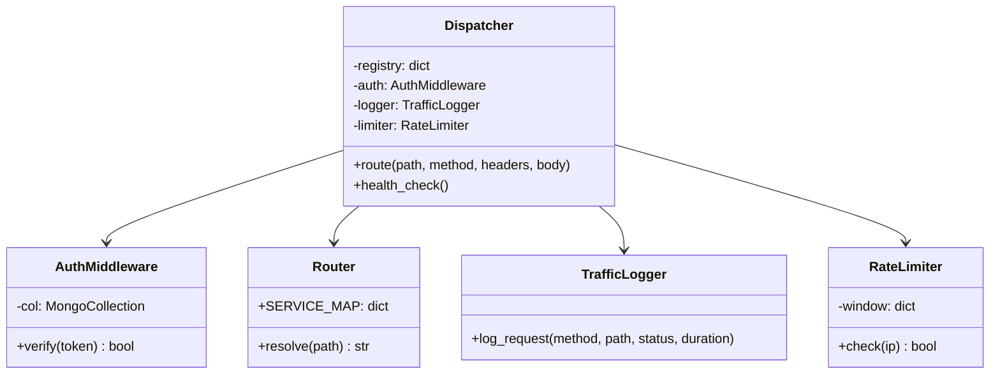

# Proje Raporu — Dispatcher Microservice API Gateway

**Ekip:** Muhammed Emir Karaman & Nuh  
**Tarih:** Mart–Nisan 2026

---

## 1. Giriş

Bu proje, modern yazılım geliştirme süreçlerinin temelini oluşturan **Mikroservis Mimarisi** ve servisler arası trafik yönetimini sağlayan bir **Dispatcher (API Gateway)** yazılımının uçtan uca geliştirilmesini amaçlamaktadır.

### 1.1 Problemin Tanımı

Monolitik yapılar ölçeklenebilirlik ve bakım açısından ciddi sorunlar doğurur. Bu projede bağımsız mikroservisler, merkezi bir Dispatcher aracılığıyla yönetilmekte; güvenli ve ölçeklenebilir bir yapı oluşturulmaktadır.

### 1.2 Amaçlar

- Dispatcher üzerinden tüm dış istekleri karşılamak
- TDD (Test-Driven Development) ile yüksek kaliteli kod üretmek
- OOP ve SOLID prensiplerini uygulamak
- Docker ile tüm sistemi konteyner ortamında çalıştırmak
- k6 ile profesyonel yük testi yapmak

---

## 2. Sistem Tasarımı

### 2.1 Mimari Genel Bakış

### 2.2 Network Isolation

Mikroservisler yalnızca Docker iç ağında çalışır. Dışarıya yalnızca Dispatcher'ın 8080 portu açıktır. Bu durum `docker-compose.yml` içindeki `internal: true` ağ ayarıyla sağlanmaktadır.

---

## 3. Servis Tasarımları

### 3.1 Dispatcher (API Gateway)

#### Richardson Maturity Model — Seviye 2

| Kaynak | URI | HTTP Metodu | Durum Kodu |
|--------|-----|-------------|------------|
| Kullanıcılar | `/users` | GET | 200 |
| Kullanıcı | `/users/{id}` | GET | 200 / 404 |
| Yeni kullanıcı | `/users` | POST | 201 |
| Güncelle | `/users/{id}` | PUT | 200 / 404 |
| Sil | `/users/{id}` | DELETE | 204 / 404 |
| Giriş | `/auth/login` | POST | 200 / 401 |
| Kayıt | `/auth/register` | POST | 201 / 409 |
| Mesaj gönder | `/messages` | POST | 201 |

#### Sınıf Diyagramı

---

## 4. Richardson Olgunluk Modeli

<!-- Seviye 3 uygulanırsa +5 puan bonus -->

- **Seviye 0** — Tek URL, tek metot ❌
- **Seviye 1** — Kaynak bazlı URI ✅
- **Seviye 2** — HTTP metotları + durum kodları ✅
- **Seviye 3** — HATEOAS (hypermedia bağlantıları) *(hedef)*

---

## 5. Test Senaryoları ve Sonuçlar

*(Bu bölüm testler tamamlandıkça doldurulacak)*

---

## 6. Yük Testi Sonuçları

*(k6 testleri tamamlandıkça eklenecek)*

| Eş Zamanlı Kullanıcı | Ort. Yanıt (ms) | p95 (ms) | Hata Oranı |
|----------------------|-----------------|----------|------------|
| 50 | — | — | — |
| 100 | — | — | — |
| 200 | — | — | — |
| 500 | — | — | — |

---

## 7. Ekran Görüntüleri

*(Sistem çalışır hale gelince eklenecek)*

---

## 8. Sonuç ve Tartışma

*(Proje tamamlandıkça doldurulacak)*

### Başarılar
- 

### Sınırlılıklar
- 

### Olası Geliştirmeler
- 
