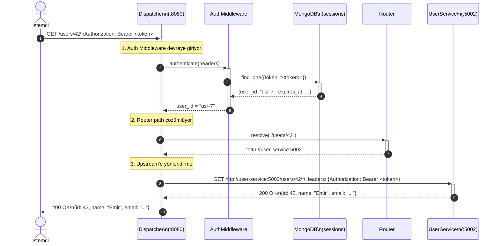
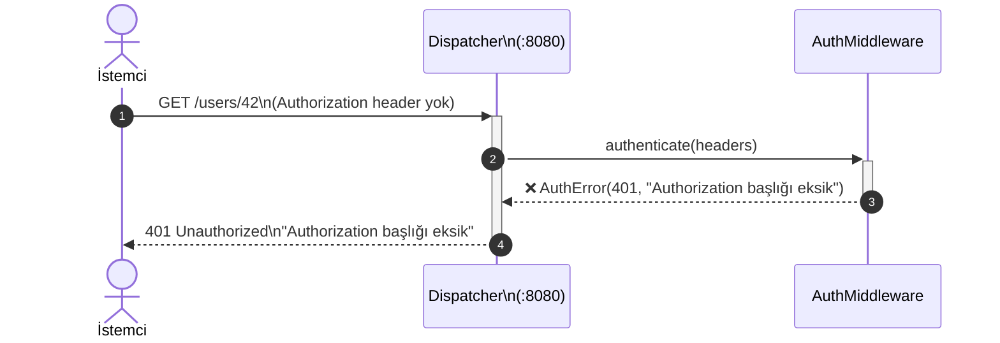
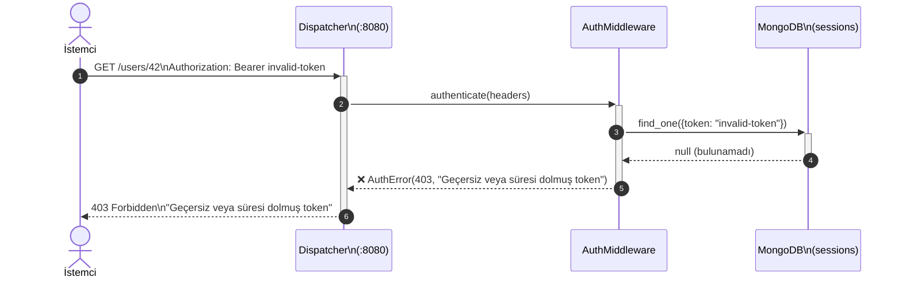
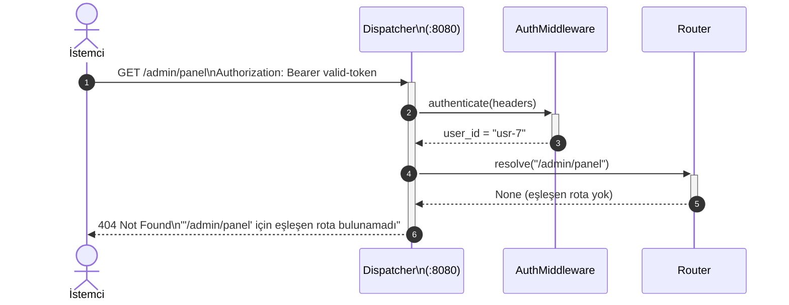
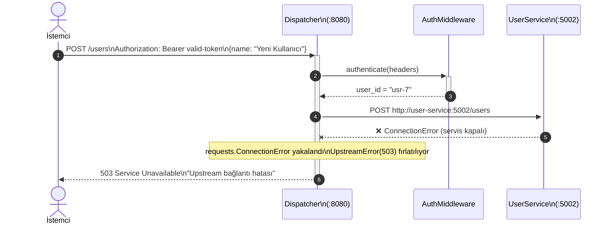
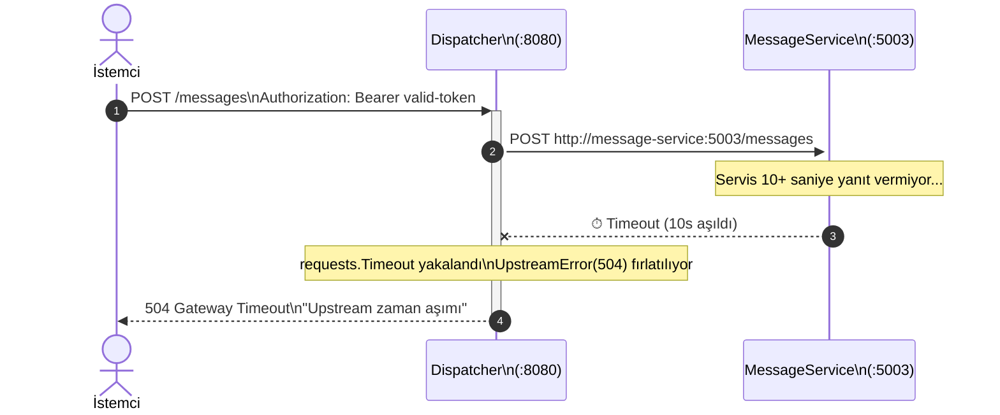
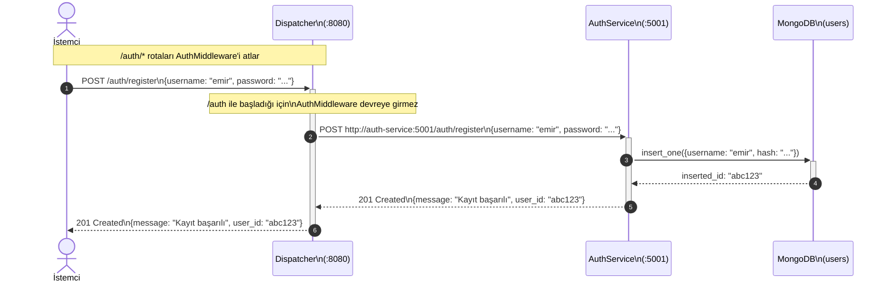
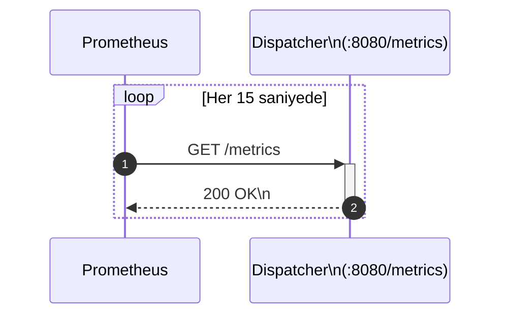

# Sıralama Diyagramları — Dispatcher Routing Flow

**Commit 29 — 1 Nisan 2026 | Emir**  
`docs: add sequence diagrams for dispatcher routing flow (Mermaid)`

---

## 1. Başarılı İstek — Tam Akış

---

## 2. Kimlik Doğrulama Hatası (401 — Token Eksik)

---

## 3. Geçersiz Token (403 — Token Bulunamadı)

---

## 4. Bilinmeyen Route (404 — Rota Yok)

---

## 5. Upstream Servis Hatası (503 — Bağlantı Reddedildi)

---

## 6. Zaman Aşımı (504 — Gateway Timeout)

---

## 7. Kullanıcı Kaydı Akışı (Auth Service)

---

## 8. Prometheus Metrics Akışı

